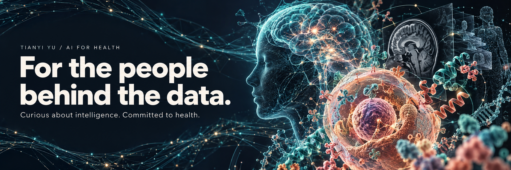

[Home](README.md) · [About](sections/about.md) · [Research](sections/research.md) · [Projects](sections/projects.md) · [Approach](sections/approach.md) · [Connect](sections/connect.md)

[Visit my website](https://terry0809000.github.io/) · [Meet me](https://github.com/terry0809000) · [Google Scholar](https://scholar.google.com/citations?user=m8F5KU8AAAAJ) · [ORCID](https://orcid.org/0009-0009-0311-4015)

A clinical note holds someone's story. An image can carry a clue that is easy to miss. A risk score may shape what happens next.

That is what draws me to AI for health. I want to understand what these tools can learn, where they fall short, and what it would take to make them useful to the people who depend on them.

I'm **Tianyi Yu**. I work across clinical language, biomedical imaging and prediction modelling, with a particular interest in trust: does a promising result survive a new hospital, a different population, or the messiness of everyday care?

This is where I share the code behind those questions. Pick a project, look under the hood, and try it with your own questions. I'd love to hear what you find.

**12 selected research projects · 6 connected directions**

## Research constellation

[View full-size mind map](figures/selected-projects-cosmos.png) · [Editable SVG](figures/selected-projects-cosmos.svg) · [Mermaid source](figures/selected-projects.mmd)

AI-generated conceptual science-fiction background; project labels and connections are editable vectors. This is a portfolio map, not experimental evidence.

## Explore the projects

| Direction | Selected projects |
|:--|:--|
| **[Clinical NLP](directions/clinical-nlp.md)** · 3 projects | [Social and behavioural determinants from clinical text](https://github.com/terry0809000/MIMIC_SBDH) [Cross-corpus abstract classification](https://github.com/terry0809000/biomedical-abstract-sentence-classification) [Beyond Macro-F1](https://github.com/terry0809000/beyond-macro-f1-pubmed-rct-public) |
| **[Computer Vision](directions/biomedical-imaging.md)** · 2 projects | [Selective skin-lesion referral](https://github.com/terry0809000/ham10000-trustworthy-skin-ai) [MRI and clinical prediction of pathological complete response](https://github.com/terry0809000/breast-mri-response-prediction) |
| **[Trustworthy AI](directions/trustworthy-ai.md)** · 2 projects | [Measurement-aware ICU prediction](https://github.com/terry0809000/icu-measurement-aware-prediction) [Clinical prediction uncertainty and identification](https://github.com/terry0809000/clinical-uncertainty-identification) |
| **[Prediction Modelling](directions/prediction-modelling.md)** · 1 project | [Dynamic AKI prediction](https://github.com/terry0809000/aki-dynamic-prediction-deployment-gated) |
| **[Health Informatics](directions/health-informatics.md)** · 2 projects | [Six-hour ICU laboratory prediction](https://github.com/terry0809000/icu-six-hour-lab-prediction) [Eating disorder dynamics across everyday moments](https://github.com/terry0809000/eatingdisordermlvar) |
| **[AI for Health](directions/ai-for-health.md)** · 2 projects | [Sleep-EDF staging](https://github.com/terry0809000/sleepingedf) [Adaptive versus fixed smartwatch task acquisition](https://github.com/terry0809000/pads-adaptive-acquisition) |

[How I approach research](sections/approach.md) · [Continue the conversation](sections/connect.md)
