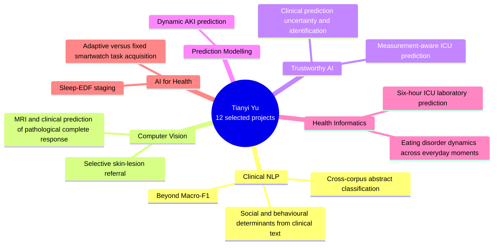

# Twelve projects, six research directions

[View full-size mind map](selected-projects-cosmos.png) · [Editable SVG](selected-projects-cosmos.svg) · [Mermaid source](selected-projects.mmd)

AI-generated conceptual science-fiction background; project labels and connections are editable vectors. This is a portfolio map, not experimental evidence.

