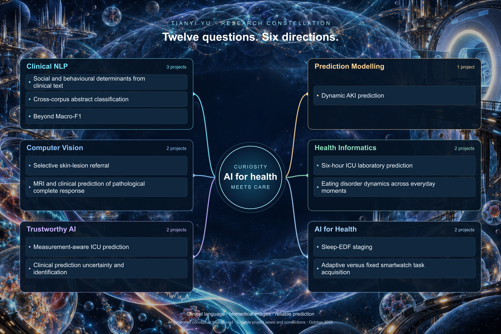

[Home](../README.md) · [About](about.md) · [Research](research.md) · [Projects](projects.md) · [Approach](approach.md) · [Connect](connect.md)

# Six directions, twelve questions

[View full-size mind map](../figures/selected-projects-cosmos.png) · [Editable SVG](../figures/selected-projects-cosmos.svg) · [Mermaid source](../figures/selected-projects.mmd)

AI-generated conceptual science-fiction background; project labels and connections are editable vectors. This is a portfolio map, not experimental evidence.

| Direction | Selected projects |
|:--|:--|
| **[Clinical NLP](../directions/clinical-nlp.md)** · 3 projects | [Social and behavioural determinants from clinical text](https://github.com/terry0809000/MIMIC_SBDH) [Cross-corpus abstract classification](https://github.com/terry0809000/biomedical-abstract-sentence-classification) [Beyond Macro-F1](https://github.com/terry0809000/beyond-macro-f1-pubmed-rct-public) |
| **[Computer Vision](../directions/biomedical-imaging.md)** · 2 projects | [Selective skin-lesion referral](https://github.com/terry0809000/ham10000-trustworthy-skin-ai) [MRI and clinical prediction of pathological complete response](https://github.com/terry0809000/breast-mri-response-prediction) |
| **[Trustworthy AI](../directions/trustworthy-ai.md)** · 2 projects | [Measurement-aware ICU prediction](https://github.com/terry0809000/icu-measurement-aware-prediction) [Clinical prediction uncertainty and identification](https://github.com/terry0809000/clinical-uncertainty-identification) |
| **[Prediction Modelling](../directions/prediction-modelling.md)** · 1 project | [Dynamic AKI prediction](https://github.com/terry0809000/aki-dynamic-prediction-deployment-gated) |
| **[Health Informatics](../directions/health-informatics.md)** · 2 projects | [Six-hour ICU laboratory prediction](https://github.com/terry0809000/icu-six-hour-lab-prediction) [Eating disorder dynamics across everyday moments](https://github.com/terry0809000/eatingdisordermlvar) |
| **[AI for Health](../directions/ai-for-health.md)** · 2 projects | [Sleep-EDF staging](https://github.com/terry0809000/sleepingedf) [Adaptive versus fixed smartwatch task acquisition](https://github.com/terry0809000/pads-adaptive-acquisition) |
